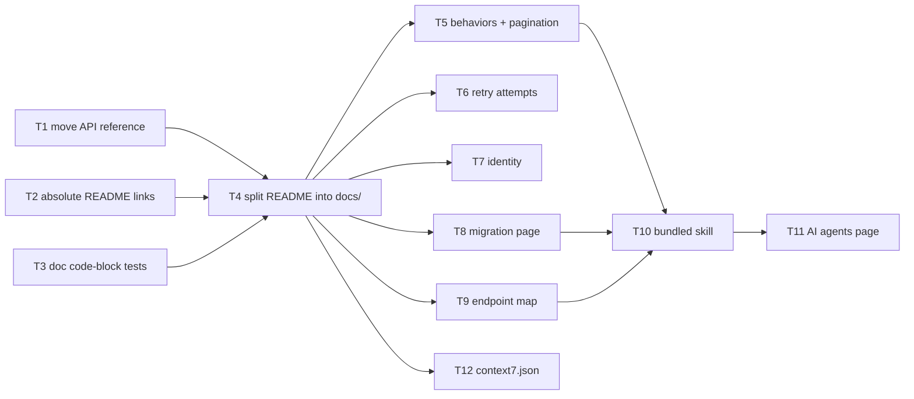

# Review: user docs and agent guidance

Recommendations for documenting discogs-sdk for users and their coding agents, and a plan to implement them.
Everything below was checked against the repository at `v0.7.0` (commit `3434d97`). Every task follows
AGENTS.md: branch naming, async-first sources, Nine Inch Nails data in every example, one pull request per task.

Out of scope: choosing a docs generator, hosting, and the publishing pipeline. That is a separate effort. Until
it happens, the pages in `docs/` must render correctly as plain Markdown on GitHub.

## Verified facts

Implementers can rely on these without re-checking.

| Topic | Fact | Evidence |
|---|---|---|
| Sync docstrings | `Discogs.__doc__` describes the sync client with a sync example; issue #25 is closed | `help(discogs_sdk.Discogs)` |
| Earlier drift issues | #32, #40 and #59 are closed; `tests/test_examples_behavior.py` runs the write-heavy example scripts | `gh issue view` |
| Cache clearing on writes | PR #104 merged before `v0.6.0`; README lines 406–410 describe it | `gh pr view 104` |
| Build backend | `uv_build`, not Hatch. A `src/discogs_sdk/.agents/skills/discogs-sdk/SKILL.md` ships in both the wheel and the sdist with no configuration | Test build of a throwaway copy |
| Identity | `client.user.identity()` (`_async/resources/users.py:200`). The README never mentions it; only `examples/authentication.py:76` does | grep |
| Listing condition | `condition: Condition` is a `Literal`, e.g. `"Very Good Plus (VG+)"` | `_async/resources/marketplace.py:168` |
| `model_dump()` keys | Python field names (`extra_artists`), not API names | `Release.model_validate(...).model_dump()` |
| Explicit fetch | No public fetch method. Sync: reading any data attribute fetches. Async: `await` the proxy | `_async/_lazy.py:122-142` |
| Errors on old idioms | Python already prints `AttributeError: 'Discogs' object has no attribute 'release'. Did you mean: 'releases'?` | Run under the repo's Python 3.13 |
| Pagination | 16 of the 18 `.list()` methods return `AsyncPage`/`SyncPage` and take `per_page`. `CollectionFolders.list()` (`collection.py:232`) and `CollectionFields.list()` (`collection.py:297`) return a plain `list` and take no `per_page` | AST scan of `_async/resources/` |
| Pagination in README | The README never states the cost per page, `per_page`, or the lack of `len()`/slicing | grep |
| Retry count | The README says "Max retries" (config table, line 379) and "`attempts` (`1` = no retry)" (line 545), but never states that `max_retries=3` means up to 4 attempts | README |
| PyPI long description | `pyproject.toml` sets `readme = "README.md"`. The README's 10 relative links (`examples/…`, `CONTRIBUTING.md`) are broken on PyPI | `pyproject.toml:9`, README lines 94, 356–364, 707 |
| Vendored API reference | `docs/discogs_api/` is git-ignored for copyright reasons and sits where user docs will go | `.gitignore:7` |
| Context7 | This repository is not indexed. Context7's "Discogs SDK" is `/crate-ai/discogs-sdk`, an unrelated project; `/joalla/discogs_client` (the predecessor, 215 snippets) also comes up | `resolve-library-id "discogs-sdk"` |
| Endpoint extraction | `scripts/check_endpoint_coverage.py::_sdk_routes()` returns a set of route templates only, with no HTTP verb, resource class or method name | Script source |

## Recommendations

1. Move the vendored API reference out of `docs/`, so a docs build can never publish it.
2. Use absolute links in README.md so they also work on PyPI.
3. Execute the fenced Python blocks in README.md and `docs/` under the mocked router.
4. Split the long reference sections of README.md into pages under `docs/`. The README stays the landing page.
5. Add a "Behaviors to know" block covering lazy errors, pagination cost (qualified as in the table above), async, retries and caching.
6. State that the default `max_retries=3` means up to 4 attempts.
7. Document `client.user.identity()`.
8. Add a migration page from python3-discogs-client with a translation table.
9. Generate an endpoint → SDK method map.
10. Ship a version-matched agent skill inside the wheel, with references generated from `docs/` and a staleness check.
11. Add an "AI coding agents" docs page and a short README pointer.
12. Add `context7.json` and register the repository with Context7.

### Rejected

| Proposal | Reason |
|---|---|
| `__getattr__` on the clients or the module that names the right call for old idioms | Python's "Did you mean" already covers `release`/`artist`/`master`/`label`. A declared `__getattr__` would make type checkers accept any attribute name. |
| llms.txt / llms-full.txt | Needs a published site, and coding agents do not read it unless pointed at it. Revisit with the publishing work. |
| Separate FAQ page | Its questions are answered by tasks T5 and T8. |
| Full retry matrix | README lines 100–117 already cover each failure class; only the attempt count is missing (T6). |
| Fixing sync docstrings (#25), examples drift (#32, #59), cache types (#40), cache clearing (#104) | Already done. |

## Plan



T1, T2 and T3 can run in parallel. T5–T9 and T12 can run in parallel after T4, but they edit different pages
and may all touch the README's link list, so expect small rebases.

---

### T1. Move the vendored API reference out of `docs/`

**Why.** `docs/` is about to hold publishable user docs. A generator pointed at `docs/` on a maintainer's machine
would include the copyrighted reference, and an exclude rule is easy to lose.

**Change.** Move it to `reference/discogs_api/`. Update every occurrence of the path:

- `.gitignore:7`
- `AGENTS.md` lines 31 and 194 (and the paragraph after 194)
- `CONTRIBUTING.md:56`
- `justfile:128` (comment)
- `scripts/update_api_docs.py` (docstring, `OUTPUT_DIR` at line 32, help text at 272, message at 323)
- `scripts/check_endpoint_coverage.py` (docstring line 8, `API_DOCS` at line 50)
- `tests/documented_payloads.py:3`

Mention in the PR description that the directory is git-ignored, so each existing local copy must be moved by
hand (`mv docs/discogs_api reference/`).

**Acceptance.**
- No occurrence of `docs/discogs_api` or `"docs" / "discogs_api"` remains.
- `just update-api-docs` (report mode, no `--write`) and `just check-endpoints` both find the moved copy.
- `just qa` and `just test` pass.

---

### T2. Absolute links in README.md

**Why.** README.md is the PyPI long description, and relative links break there. T4 will add many more links.

**Change.**
- Rewrite every relative link in README.md to `https://github.com/jmfontaine/discogs-sdk/blob/main/<path>`
  (`tree/main/` for directories such as `examples/`).
- Add a test in `tests/` that fails when README.md contains a Markdown link or image whose target is neither
  absolute (`http://`, `https://`) nor an in-page anchor (`#…`). This guards a consumer-visible defect: broken
  links on PyPI.

**Acceptance.** The new test passes, and it fails when a relative link is added back. `just qa` passes.

---

### T3. Execute the fenced code blocks in README.md and `docs/`

**Why.** Only `examples/` is exercised today: `tests/test_examples.py` checks imports, and
`tests/test_examples_behavior.py` runs four scripts. The README's Python blocks never run. T4 spreads them over
about a dozen pages, which multiplies the room for drift (#32 was this kind of drift in `examples/`).

**Change.**
- Add `tests/test_doc_examples.py`. It lives in `tests/`, not the async/sync trees, because it is not
  client-specific. It collects every ` ```python ` block from `README.md` and `docs/**/*.md` (the glob may match
  nothing until T4 lands).
- Run each file's blocks in order in one namespace, so a fragment can use the `client` an earlier block created.
  Pre-seed the namespace with `client = Discogs(token="test")` for blocks that assume one.
- Run under `mock_router(...)` from `tests/conftest.py`. Never call `respx.mock` directly; AGENTS.md explains why.
  Serve payloads from the existing factories (`make_release()`, …). A block that deliberately fails, such as the
  `NotFoundError` example (README line 249), needs a 404 route.
- Run a block containing `asyncio.run(main())` as written, under the same router.
- Skip a block only through an explicit marker, an HTML comment `<!-- doc-test: skip (reason) -->` on the line
  before the fence, and require a reason. Use it for blocks that are not standalone, such as the custom cache
  backend class skeleton, if they cannot be made runnable.
- Placeholders such as `"your_username"` and `123456789` get routes; leave the README text unchanged.
- `pytest-examples` is an option. Pick it only if it supports the shared namespace and the respx router; otherwise
  write a small collector.

**Acceptance.**
- Every Python block in README.md either runs or carries a skip marker with a reason.
- Breaking a method name in one README block (local experiment, not committed) makes the test fail and name the
  file and line.
- `just test` passes and stays offline. The strict router must reject any unmocked request.

---

### T4. Split README.md into `docs/` pages

**Depends on:** T1, T2, T3.

**Change.** Move the content verbatim first and edit afterwards, so the diff stays reviewable. Plain CommonMark
plus GitHub alerts (`> [!NOTE]`) only. No syntax specific to one generator (`!!!` admonitions, snippet includes,
mkdocstrings directives) until a generator is chosen.

| New page | Content moved from README.md |
|---|---|
| `docs/README.md` | New index: one line per page, in reading order |
| `docs/getting-started.md` | Install, quick start (sync and async), fetching, search, sub-resources (lines 24–33, 61–62, 119–187) |
| `docs/authentication.md` | Lines 63–98 |
| `docs/errors-and-retries.md` | Lines 99–117 and 243–353 |
| `docs/configuration.md` | Lines 366–391 |
| `docs/caching.md` | Lines 392–524 |
| `docs/observability.md` | Lines 525–561 |
| `docs/concurrency.md` | Lines 562–609 |
| `docs/http-clients.md` | Lines 610–625 |
| `docs/models.md` | Lines 626–704 (field naming, timestamps, original API values) |
| `docs/collection-and-marketplace.md` | Lines 188–242 |

Line numbers refer to README.md at `v0.7.0`; match on section headings if they have shifted.

README.md keeps:
- the title, badges and pitch
- the feature list
- "How it compares" (`check_endpoint_coverage.py --compare-upstream` probes this table in README.md; do not move it)
- installation
- a sync and an async quick start of about 10 lines each
- the "Examples" list
- "Contributing", "License"
- a "Documentation" section linking each page with absolute URLs (T2's test enforces this)

Pages under `docs/` link to each other relatively.

Add a "User docs" section to AGENTS.md:
- Pages live in `docs/` and render on GitHub as plain Markdown; there is no generator yet.
- Examples use Nine Inch Nails data and show both clients wherever behaviour differs.
- Every Python block is executed by `tests/test_doc_examples.py`.
- The vendored API reference lives in `reference/discogs_api/`.

Update the AGENTS.md references to "the Field naming table in README.md" so they point at `docs/models.md`.

**Acceptance.**
- Every sentence removed from README.md exists in exactly one page. Check this with a word-level diff of the
  removed lines against the new pages.
- T3's test runs every block in its new location.
- `just check-endpoints --compare-upstream` still finds the comparison table.
- `just qa` and `just test` pass.

---

### T5. "Behaviors to know" block and the pagination page

**Depends on:** T4.

**Change.**
- Add the block to README.md directly after the quick start, and a fuller version at the top of
  `docs/getting-started.md`. One or two sentences per item, each linking to its page:
  - **Lazy loading.** `.get()` sends no request; the first data attribute access does, and that is where
    `NotFoundError` is raised. In the sync client, reading an attribute is the only way to force the fetch.
    Explain the `_ = release.title` line in the error-handling example.
  - **Async.** `await` the proxy and use `async for`. Accessing an attribute on an unresolved async proxy raises
    `AttributeError` (`_async/_lazy.py:128`).
  - **Pagination cost.** Wording, verified against the code:
    > Paginated methods (`search()` and the `.list()` methods returning `SyncPage`/`AsyncPage`) send one request
    > per page, and each counts against the 60/min limit. They take `per_page`, support no `len()` or slicing, and
    > fill in `total_items`/`total_pages` only after the first page arrives. `collection.folders.list()` and
    > `collection.fields.list()` make one request and return a plain list.

    Before writing it, confirm that `search()` passes `per_page` through (`_async/_client.py:528` takes
    `**params`) and that a `Page` has no `__len__` or `__getitem__` (`_async/_paginator.py`).
  - **Retries.** Reads retry; a mutation is never replayed after an ambiguous failure.
  - **Caching.** Off by default; only `GET`/`HEAD`; a successful write clears it.
- Create `docs/pagination.md`. Move the paginator material from `docs/errors-and-retries.md` there (README lines
  308–319 at `v0.7.0`) and from `docs/concurrency.md` (lines 597–600). Add the pagination-cost text above, how to
  stop early (`break`), and the page attributes (`page`, `per_page`, `total_items`, `total_pages`, the
  `*_url` properties).

**Acceptance.** T3's test runs every new block. Each claim matches the code; reference the file and line in the
PR description.

---

### T6. State the attempt count

**Depends on:** T4.

**Change.** In the `max_retries` row of `docs/configuration.md`, and in `docs/errors-and-retries.md`, say that
`max_retries=N` allows up to N + 1 attempts, so the default 3 means up to 4. Before writing, confirm against the
retry loop in `_async/_client.py` and `_base_client.py`, and match the `attempts` field of `RequestEvent`.

**Acceptance.** The wording matches the code, checked by running a mocked read that returns 503 four times and
counting the requests (throwaway script, not committed).

---

### T7. Document `client.user.identity()`

**Depends on:** T4.

**Change.**
- In `docs/getting-started.md` (or `docs/authentication.md`), show `client.user.identity()` returning the
  authenticated user's `username`.
- In `docs/collection-and-marketplace.md`, open the collection example with
  `user = client.users.get(client.user.identity().username)` in place of the hard-coded `"your_username"`.
- Use whichever attribute name the `Identity` model actually exposes.

**Acceptance.** T3's test runs the new blocks with an `/oauth/identity` route.

---

### T8. Migration page from python3-discogs-client

**Depends on:** T4.

**Change.** Create `docs/migrating-from-python3-discogs-client.md` with a translation table, plus a section on
behaviour differences (lazy loading, iteration instead of `.page(n)`, typed models instead of `.data`, retries,
the default timeout). Verified mappings:

| python3-discogs-client | discogs-sdk |
|---|---|
| `discogs_client.Client("ua/1.0", user_token=t)` | `Discogs(token=t)`, or `Discogs()` with `DISCOGS_TOKEN` |
| `d.release(id)`, `d.artist(id)`, `d.master(id)`, `d.label(id)` | `client.releases.get(id)`, `client.artists.get(id)`, `client.masters.get(id)`, `client.labels.get(id)` |
| `d.search(q, type="release").page(1)` | `for r in client.search(query=q, type="release")` |
| `d.identity()` | `client.user.identity()` |
| `me.collection_folders[0].releases` | `client.users.get(name).collection.folders.get(0).releases.list()` |
| `me.wantlist.add(release, notes=…)` | `user.wantlist.create(release_id=…)`, then `user.wantlist.update(release_id, notes=…, rating=…)` |
| `me.inventory.add_listing(release=…, condition=Condition.MINT, price=…)` | `client.marketplace.listings.create(release_id=…, condition="Mint (M)", price=…)` |
| `d.backoff_enabled = False` | `Discogs(max_retries=0)` |
| `client.set_timeout(connect=…, read=…)` | `Discogs(timeout=…)` |
| `.data[...]`, `.fetch("key")` | Typed attributes; the original payload is in `model.raw` |
| `client._fetcher.rate_limit*` | `client.ratelimit` |

Before writing:
- Verify each left-hand idiom against the current python3-discogs-client docs, and each right-hand call by
  running it in T3's harness.
- Check the exact `Condition` literal for "Mint" in `models/marketplace.py`.
- Confirm how `timeout=` is typed in `_async/_client.py`.
- Do not claim the old library lacks a default timeout unless its current source shows that. The claim has not
  been verified.

Link the page from the README's "How it compares" section.

**Acceptance.** Every discogs-sdk call in the page runs in T3's test.

---

### T9. Generated endpoint → SDK method map

**Depends on:** T4.

**Change.**
- Extend `scripts/check_endpoint_coverage.py`, or add a sibling script that reuses its AST helpers, to produce one
  row per SDK operation. Columns: HTTP verb, route template, sync call
  (`client.releases.get(id)` / `….rating.update(...)`), return type, paginated (yes when the return type is a
  `Page`).
- Today `_sdk_routes()` keeps only route templates, so the extraction has to also record the enclosing class,
  the method name and the HTTP verb from `self._get`/`_post`/`_put`/`_delete`/`_post_file`/`_get_binary`.
- Mapping a resource class to its public access path (`client.users.get(u).collection.folders`) needs the
  accessor chain from `_async/_client.py` and each proxy's properties. Derive it, or keep a small explicit table
  in the script that a check validates against the classes.
- Read only the SDK sources, never `reference/discogs_api/`, which is absent in CI.
- Write `docs/endpoints.md`. Add `just generate-endpoints` and a `--check` mode, and wire the check into
  `just qa` the way `sync-check` is.

**Acceptance.**
- Every route that `_sdk_routes()` reports appears in the table.
- `--check` fails after a resource method is renamed (local experiment).
- `just qa` passes.

---

### T10. Bundled agent skill

**Depends on:** T5, T8, T9.

**Change.**
- Create `src/discogs_sdk/.agents/skills/discogs-sdk/SKILL.md` (the library-skills convention; `uv_build` ships
  it unchanged).
- Front matter: `name: discogs-sdk`. The `description` says to use the skill when Python code imports
  `discogs_sdk` (PyPI `discogs-sdk`, `github.com/jmfontaine/discogs-sdk`), and that it is not
  python3-discogs-client (`import discogs_client`) and not `crate-ai/discogs-sdk`.
- Body: short do/don't rules, each one line with a short example when needed:
  1. Identify the library from `pyproject.toml`/the lockfile and the imports. Never mix it with `discogs_client`.
  2. Lifecycle: `with Discogs() as client:` / `async with AsyncDiscogs() as client:`, one client per program
     rather than per request, and tokens from `DISCOGS_TOKEN`, never hard-coded.
  3. Lazy loading: put `try`/`except NotFoundError` around the attribute access, not just `.get()`. Sub-resource
     accessors do not fetch the parent.
  4. Async: `await` proxies, use `async for`, never call the sync client from async code.
  5. Pagination: the T5 wording; `break` early; never `list()` a large result set.
  6. Rate limits: the SDK does not pace requests; check `client.ratelimit.remaining` in bulk loops; do not wrap
     reads in another retry layer.
  7. Writes: after `DiscogsConnectionError` on `POST`/`PUT`/`DELETE`, read the state back before retrying.
  8. Caching: off by default; `no_cache()`, `cache_only()` and `CacheMissError`.
  9. Use Python field names (`catalog_number`, `extra_artists`, …).
  10. A custom `http_client` must be an `httpx2` client, never `httpx`; the SDK does not close it.
  11. Never import `discogs_sdk._*`. Never call api.discogs.com directly when an SDK method exists.
- Add `references/` with copies of `docs/migrating-from-python3-discogs-client.md`, `docs/endpoints.md`,
  `docs/pagination.md`, `docs/errors-and-retries.md` and `docs/caching.md`. `SKILL.md` names each and says when
  to open it.
- Add `just generate-skill-refs`, which copies those pages into `references/` and rewrites links between pages to
  point at the copies, or at absolute GitHub URLs for pages that are not copied. Add a `--check` mode wired into
  `just qa`. Never edit `references/` by hand; say so in AGENTS.md.
- Add `discogs_sdk/.agents/skills/discogs-sdk/SKILL.md` to `WHEEL_REQUIRED` in `scripts/check_distributions.py`.
- Include `SKILL.md` in T3's collector so its Python blocks execute.
- Add a test that every `client.<path>` named in `SKILL.md` resolves to a real attribute on `Discogs`, walking
  proxies without HTTP.

**Acceptance.**
- `uv build` followed by `uv run python scripts/check_distributions.py dist` passes and lists the skill.
- `unzip -l dist/*.whl` shows `SKILL.md` and `references/`.
- `just qa` and `just test` pass.
- Deleting a line from `docs/pagination.md` makes the `--check` mode fail.

---

### T11. "AI coding agents" page

**Depends on:** T10.

**Change.**
- Create `docs/ai-agents.md`:
  - How to install the bundled skill with `uvx library-skills`, plus the flag Claude Code needs.
    **Re-verify the current commands and flags against https://library-skills.io/ before writing.** They have
    not been checked yet.
  - A paste-in snippet of 15 lines or fewer for `AGENTS.md`, `.cursor/rules/` or
    `.github/copilot-instructions.md`, condensed from rules 1, 3, 4, 5 and 10 of the skill.
- Link the page from the README's Documentation section.

**Acceptance.** The installation commands were run once against a scratch project that depends on a locally
built wheel, and the skill appeared where the docs say. Record the output in the PR description.

---

### T12. Context7

**Depends on:** T4.

**Change.**
- Add `context7.json` at the repository root, following the current schema at
  https://context7.com/docs/library-owners. Index `README.md`, `docs/` and `examples/`; exclude `reference/`,
  `tests/`, `scripts/` and `src/`. Add rules saying this is `jmfontaine/discogs-sdk` (PyPI `discogs-sdk`), not
  `crate-ai/discogs-sdk` or python3-discogs-client.
- Registering the repository on context7.com is a manual step for the maintainer. List it in the PR description;
  the agent must not attempt it.

**Acceptance.**
- `context7.json` validates against the published schema.
- After registration (maintainer), `resolve-library-id "discogs-sdk"` returns this repository.
